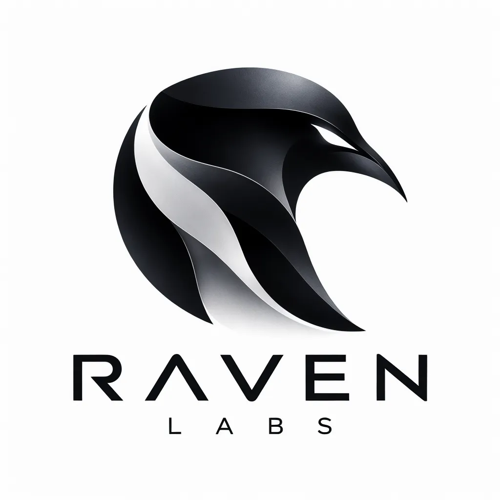

<div align="center">

  

  # RavenLabs

  **Dismantling artificial platform borders through high-performance engineering.**

  [](LICENSE)
  [](#roadmap)
  [](https://ravennotch.me)
  [](#platform-support)

  [Overview](#-the-philosophy) • [Products](#-flagship-products) • [Architecture](#-design--tech-stack) • [Roadmap](#-roadmap) • [Contributing](#-contributing)

</div>

---

## ⚡ The Philosophy

> *"If an exceptional app is locked in a walled garden, we reverse-engineer a native, high-performance twin for everyone else."*

Modern computing has become fractured by artificial exclusivity. Operating systems gatekeep intuitive UI paradigms and micro-interactions behind ecosystem walls. 

**RavenLabs** is an independent software collective founded to challenge this status quo. We take premier, platform-locked experiences and re-architect them from the ground up as lightweight, native, and uncompromising desktop utilities for Windows and Linux.

---

## 🛠️ Core Principles

| Principle | Our Standard |
| :--- | :--- |
| **🚀 Native Performance** | Compiled directly with modern systems languages (Rust, C++, Slint). Zero heavy web-wrapper overhead. |
| **🔒 Privacy by Default** | 100% telemetry-free, offline-first execution. Your desktop activity never leaves your local hardware. |
| **🎯 Aesthetic Precision** | Pixel-perfect typography, fluid 120Hz+ spring physics, and organic micro-interactions tailored for desktop workflows. |
| **🌐 Cross-Platform Freedom** | Engineered to bridge the gap between Windows and Linux, respecting each platform's native windowing paradigms. |

---

## 🦅 Flagship Products

### 1. [Raven Notch](https://ravennotch.me) — *Dynamic Island for Windows & Linux*

Our debut production release reimagines notch and dynamic island interaction models specifically for multi-monitor desktop environments.

- **Fluid Media Island**: Seamless now-playing HUD with reactive waveforms and real-time audio controls.
- **Hardware Telemetry**: Instant glances at CPU load, memory headroom, battery health, and thermal throttles.
- **Micro Clipboard & Drop Shelf**: Drag-and-drop staging area for fast file sharing and scratchpad storage.
- **Dedicated Site**: [ravennotch.me](https://ravennotch.me)
- **Source Code**: [RaunakxShrivastva/Raven-Island](https://github.com/RaunakxShrivastva/Raven-Island)

---

## 🔬 Active Collective Experiments Pipeline

Beyond Raven Notch, the collective is actively engineering native replacements for platform-locked desktop utilities:

- **EXP-02 · Raven DropShelf**: Universal desktop drag-and-drop staging area for multi-monitor workspaces with zero-copy file buffer architecture.
- **EXP-03 · Raven RayLauncher**: Sub-millisecond keyboard workflow palette and deep OS query system compiled natively without Chromium or Electron wrappers.

---

## ✨ Web Experience & Motion Engine

The RavenLabs brand website is crafted with zero-dependency native web standards:

- **Early Access Dispatch**: Direct collective email signup pill with local client persistence and celebratory audio chime.
- **Ambient Trailing Ring Cursor**: Fluid physics-interpolated dual-layer cursor with magnetic scale triggers on interactive elements.
- **Systems Architecture Specs**: Embedded telemetry metrics highlighting Rust (Zero GC), Slint / DirectComposition, <14MB idle RAM, and <0.4ms native UI latency.
- **Floating Back-to-Top**: Smooth scroll-triggered glassmorphic control with tactile haptic tone.
- **Synthesized Tactile Audio**: Real-time micro-haptics generated dynamically via Web Audio API oscillators.
- **SEO & Search Rich Snippets**: Schema.org JSON-LD graph metadata for verified Organization and SoftwareApplication entities.
- **Keyboard Shortcuts Navigation**: Press `T` for instant dark/light theme switching, `M` for audio mute/unmute, `?` for shortcuts help toast, and `B` for smooth scroll to top.
- **Click-to-Copy Micro-Toast**: Quick founder contact copying with haptic feedback.
- **Spotlight Cursor Optics & 3D Tilt**: Perspective calculations following user cursor trajectory.
- **Ambient Mesh Drift**: Fluid multi-layer glow shaders creating visual depth.

---

## 🖥️ Platform Support

RavenLabs utilities and interfaces are engineered for modern desktop environments:

- **Windows**: Windows 11 & Windows 10 (DirectComposition, Win32 / WinUI integrations)
- **Linux**: Wayland & X11 (Hyprland, GNOME, KDE Plasma support)
- **macOS**: *Under evaluation for cross-utility parity*

---

## 📁 Repository Structure

```text
RavenLabs/
├── index.html                  # Main landing page markup & semantic sections
├── style.css                   # Glassmorphic dark styling & responsive grid
├── script.js                   # Smooth interactions, scroll observers & UI logic
├── image.webp                  # RavenLabs emblem & official brand identity
├── notch-icon.jpg              # Raven Notch product preview graphic
├── linux-tux-svgrepo-com.svg   # Vector platform asset for Linux support
├── .gitignore                  # Development and OS ignore rules
├── LICENSE                     # MIT Open Source License
└── README.md                   # Brand documentation and collective overview
```

---

## 🚀 Running Locally

To preview or develop the RavenLabs landing page locally:

```bash
# 1. Clone the repository
git clone https://github.com/RaunakxShrivastva/RavenLabs.git

# 2. Enter the directory
cd RavenLabs

# 3. Serve using any lightweight HTTP server
# Option A: Python 3
python3 -m http.server 8080

# Option B: Node.js (npx serve)
npx serve .
```

Open `http://localhost:8080` in your browser.

---

## 🗺️ Roadmap

- [x] Establish RavenLabs collective brand identity and mission
- [x] Launch first flagship product: **Raven Notch**
- [x] Deploy interactive, high-performance brand showcase website
- [ ] Expand Linux native support & Wayland layer-shell protocol bindings
- [ ] Introduce second confidential collective lab experiment
- [ ] Open community contributor guidelines and plugin SDK

---

## 🤝 Contributing

We welcome thinkers, systems engineers, UI/UX designers, and reverse-engineers who share our passion for open computing.

1. Fork the Project
2. Create your Feature Branch (`git checkout -b feature/AmazingFeature`)
3. Commit your Changes (`git commit -m 'feat: add some AmazingFeature'`)
4. Push to the Branch (`git push origin feature/AmazingFeature`)
5. Open a Pull Request

---

## 📜 License

Distributed under the **MIT License**. See [`LICENSE`](LICENSE) for full details.

---

<div align="center">
  <sub>Engineered with precision by <strong>RavenLabs</strong> • Crafted by <a href="https://github.com/RaunakxShrivastva">Raunak Shrivastava</a></sub>
</div>
